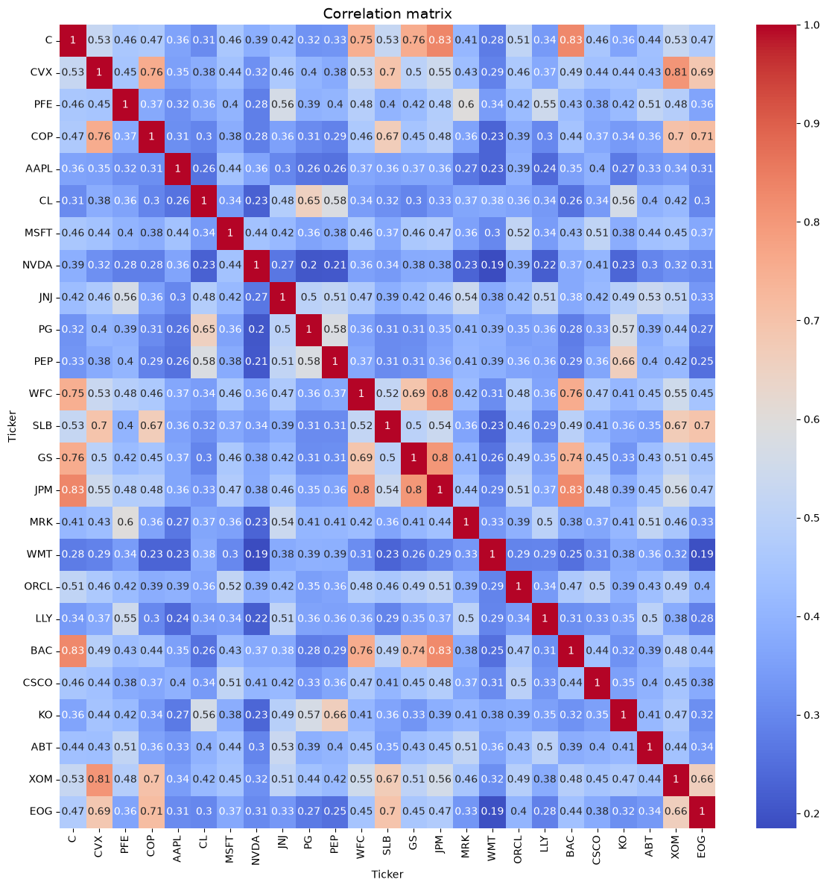
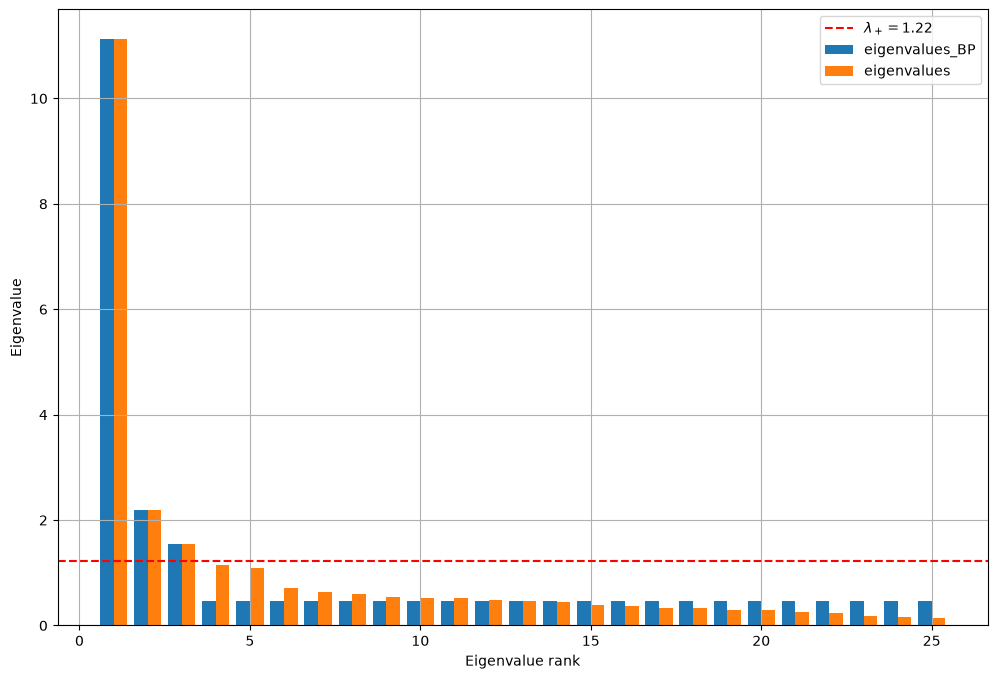
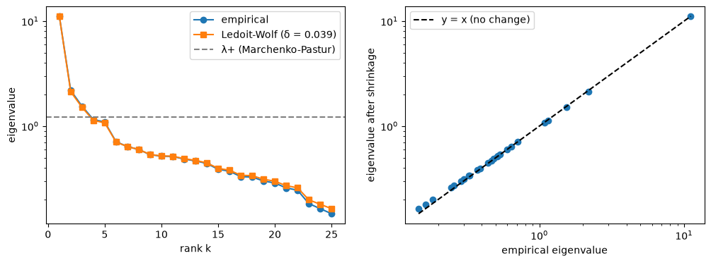
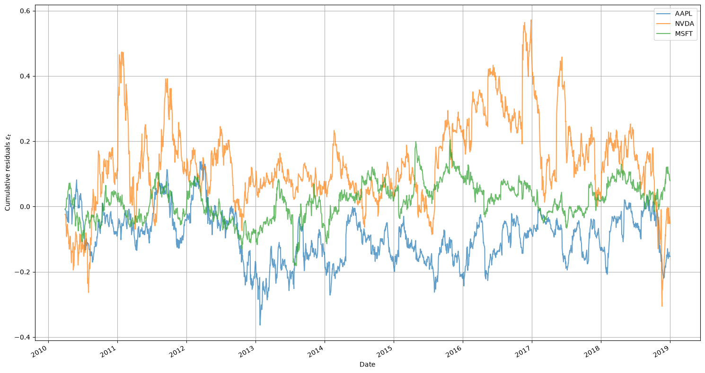
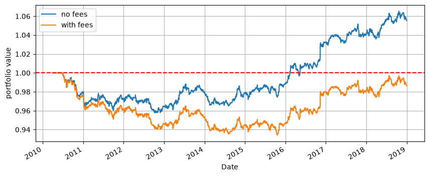

# Statistical arbitrage with PCA risk factors

Team project, CentraleSupélec, 2026. Implementation and backtest of the PCA-based statistical arbitrage strategy of Avellaneda & Lee (2010) on 25 US stocks, 2010–2018.

A 4-page summary is available in [`Statistical_Arbitrage_PCA_summary.pdf`](Statistical_Arbitrage_PCA_summary.pdf), and the full code in [`Statistical-Arbitrage-PCA.ipynb`](Statistical-Arbitrage-PCA.ipynb).

## The problem

The return of each stock $i$ is split into a part driven by risk factors common to the whole market, and a residual specific to the stock:

$$
r_{i,t} = \alpha_i + \beta_i^\top F_t + \varepsilon_{i,t}
$$

The factors $F_t$ are not observed: they are estimated statistically, by PCA. The strategy isolates the residual $\varepsilon_{i,t}$, which should no longer carry any common market risk, and bets on its mean reversion once cumulated over time. To make the strategy truly market-neutral rather than a disguised directional bet, every position on stock $i$ is hedged by opposite positions of $\beta_{i,j}$ units in each factor portfolio $j$.

The project follows four steps:

1. **Estimate the factors by PCA**, after denoising the empirical correlation matrix (Marchenko-Pastur threshold, Ledoit-Wolf shrinkage, Bouchaud-Potters clipping).
2. **Estimate the betas** with a rolling regression of each stock on the factors, and compute the residuals.
3. **Model the cumulative residuals** as an Ornstein-Uhlenbeck process and build a trading signal, the s-score.
4. **Trade and backtest** the hedged portfolios.

## Data

25 large US stocks, 5 per sector, daily adjusted closing prices from Yahoo Finance (2010–2018, $T = 2264$ daily returns).

| Sector | Tickers |
|---|---|
| Banks | JPM, BAC, C, WFC, GS |
| Energy | XOM, CVX, COP, SLB, EOG |
| Technology | AAPL, MSFT, NVDA, ORCL, CSCO |
| Healthcare | JNJ, PFE, MRK, LLY, ABT |
| Consumer staples | PG, KO, PEP, WMT, CL |

## 1. Factors: PCA and noise filtering

The correlation matrix of the returns is dominated by a market mode (all correlations are positive), with visible sector blocks, for example among the banks and among the energy stocks.



For a pure-noise correlation matrix, the eigenvalues stay below the Marchenko-Pastur bound:

$$
\lambda_+ = \left(1 + \sqrt{N/T}\right)^2 = 1.22
$$

Only three eigenvalues exceed it (11.1, 2.2 and 1.5), so we keep $k = 3$ factors: the market and two sector oppositions. The first eigenvalue alone explains 44% of the variance. Bouchaud-Potters clipping keeps these three eigenvalues and replaces all the others by their mean.



Ledoit-Wolf shrinkage towards a constant-correlation target, $\hat\Sigma_{LW} = (1-\delta)\hat\Sigma + \delta C$, gives $\delta = 0.039$. With $N/T \approx 0.01$, the estimation noise is small and denoising barely changes the spectrum.



Each retained eigenvector $v_j$ defines an eigenportfolio, with weights $Q_{ij} = v_j^{(i)}/\sigma_i$. Its daily returns are the factors: $F = R\,Q$.

## 2. Rolling regression and residuals

Each stock is regressed on the 3 factors by OLS over a rolling 60-day window, shifted by one day so that no future information is used. The cumulative residual $X_{i,t} = \sum_{s \le t} \varepsilon_{i,s}$ is the performance of the hedged portfolio.



The augmented Dickey-Fuller test rejects the random walk at the 5% level for 21 stocks out of 25 (17 at the 1% level). Three of the four exceptions are oil stocks (XOM, EOG, SLB), probably because three factors do not fully capture the oil price.

## 3. Ornstein-Uhlenbeck model and s-score

The cumulative residual is modelled as

$$
dX_t = \kappa\,(m - X_t)\,dt + \sigma\,dW_t
$$

whose exact discretization is an AR(1), $X_{n+1} = a + b\,X_n + \zeta_n$, estimated on each 60-day window:

$$\kappa = -\ln b, \qquad m = \frac{a}{1-b}, \qquad \sigma_{eq} = \sqrt{\frac{Var(\zeta)}{1-b^2}}$$

A stock is only traded if $0 < b < 1$ and its half-life $\ln 2/\kappa$ is below 30 days. The signal is the normalized distance to equilibrium:

$$
s_{i,t} = \frac{X_{i,t} - m_i}{\sigma_{eq,i}}
$$

## 4. Trading rules and backtest

The thresholds are those of Avellaneda & Lee: open a short when $s > 1.25$ and close it when $s < 0.75$; open a long when $s < -1.25$ and close it when $s > -0.5$. Each position uses $1/N$ of the capital and earns the return of the hedged portfolio, $\alpha_i + \varepsilon_{i,t}$, the next day.



| | No fees | 5 bp fees |
|---|---|---|
| Annual return | 0.63% | −0.14% |
| Annual volatility | 1.74% | 1.73% |
| Sharpe ratio | 0.36 | −0.08 |
| Max drawdown | −4.2% | −6.6% |
| Correlation with market | 0.00 | 0.00 |

## Conclusion

The strategy is market-neutral and the residuals do revert to their mean in the statistical sense, but the edge is too thin: the Sharpe ratio of 0.36 before costs disappears with 5 basis points of transaction costs. This is consistent with the decline of these strategies that Avellaneda & Lee observe after the early 2000s.

**Limitations and next steps.** The PCA is estimated once over the whole period, which introduces look-ahead bias and should be replaced by a rolling PCA. Short-selling costs are not modelled, the trading thresholds are not optimized, and the universe is small and chosen ex post (survivorship bias). Possible extensions: $k = 4$ or $5$ factors to capture energy, Kalman-filter betas, risk-based position sizing, and a universe of several hundred stocks.

## Running the notebook

```bash
pip install yfinance numpy pandas matplotlib seaborn statsmodels scipy
```

Then open `Statistical-Arbitrage-PCA.ipynb` and run all cells. The s-score cell takes about a minute.

## Reference

M. Avellaneda, J.-H. Lee, *Statistical arbitrage in the U.S. equities market*, Quantitative Finance, 10(7), 2010.
